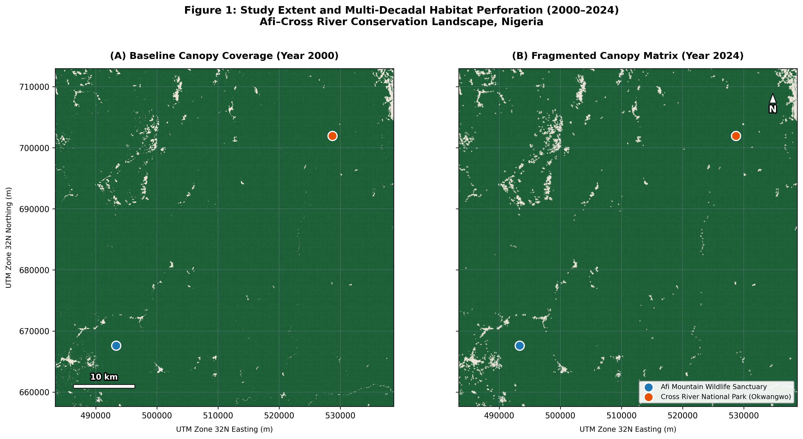
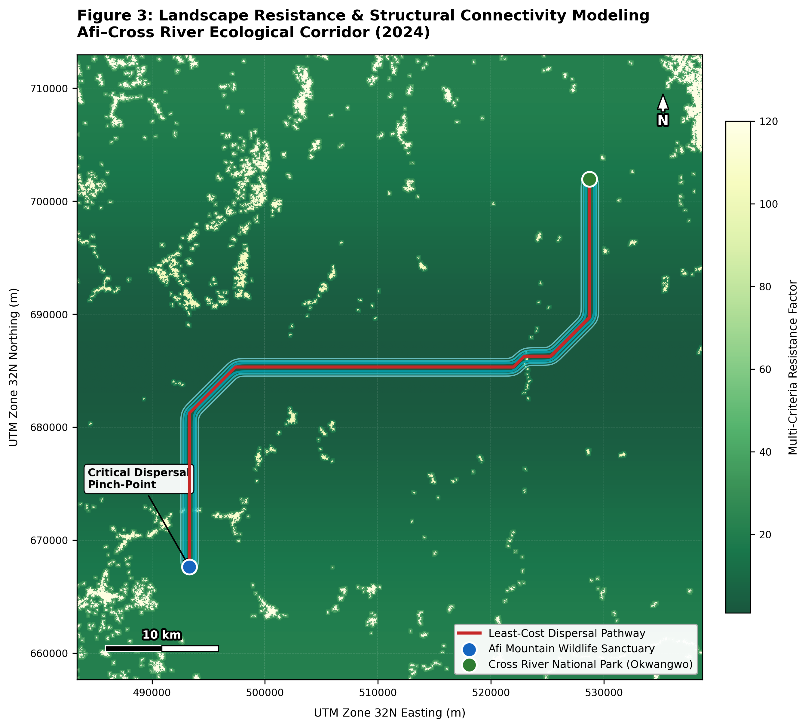

# Observational Spatial Ecology & Connectivity Modeling

**Author:** David Oloyede  
**Research Focus:** Global Environmental Change & Ecosystem Dynamics  

---

## Overview

This repository contains a reproducible computational pipeline that quantifies 24-year forest fragmentation dynamics (2000–2024) across the Afi Mountain Cross River transboundary corridor in southeastern Nigeria. Designed to evaluate structural habitat connectivity for the critically endangered Cross River gorilla (*Gorilla gorilla diehli*), the workflow integrates cloud based Earth Observation with scientific Python arrays to model landscape resistance and wildlife dispersal pathways without relying on desktop GIS software.

---

## Complete Portfolio Documentation

* **Full Written Report & Spatial Analysis:** [View Complete PDF](documents/Afi_Cross_River_Connectivity_Report.pdf)

---

## Module-by-Module Code Execution (Google Colab)

The analytical pipeline for this research is hosted in an interactive Google Colab environment for browser-based reproduction.

* **Habitat Fragmentation & Least-Cost Routing:** Computes morphological landscape metrics identifying a +481.2% patch count expansion and -83.0% mean patch area collapse—and executes Dijkstra graph traversal across a Multi-Criteria Evaluation (MCE) resistance surface to map a dispersal pathway with a 1.26 tortuosity index.  
  [Open Colab Notebook](https://colab.research.google.com/drive/1HqzZBToLo2lwRGnyW6D8UvsDER8a0SmN#scrollTo=naq8TqImgSXr)

---

## Selected Visual Synthesis

Below is a preview showing 2 of the 3 primary spatial and statistical outputs produced in this study. All figures are embedded in the full PDF report and archived inside the [Figures Folder (3 outputs)](figures/).

| Multi-Decadal Habitat Perforation (2000–2024) | Least-Cost Dispersal Pathway & Resistance (2024) |
| :---: | :---: |
|    *Canopy Baseline (2000) vs. Perforated Matrix (2024)* |    *MCE Resistance Surface & Modeled Wildlife Corridor* |

---

## Methodological Architecture & Technical Stack

| Pipeline Stage | Core Analytical Process | Technologies & Sensor Archives |
| :--- | :--- | :--- |
| **01 / Cloud Ingestion** | Multi-temporal canopy baseline (>= 40% cover) and 24-year cumulative forest loss extraction in UTM Zone 32N. | `Google Earth Engine API` · `Hansen Global Forest Change v1.12` |
| **02 / Morphological Analysis** | 8-connectivity component labeling, binary edge erosion, patch proliferation (`NP`), and effective mesh size (`m_eff`). | `scipy.ndimage` · `NumPy` · `Rasterio` |
| **03 / Resistance & Graph Routing** | Multi-Criteria Evaluation (MCE) friction parameterization and Dijkstra minimum cumulative cost traversal. | `skimage.graph` · `SciPy` |
| **04 / Cartographic Synthesis** | Planar UTM projection rendering, bottleneck annotation, and structural fragmentation dashboards. | `Matplotlib` · `Python` |

---

## Research Reflection

Looking only at total tree loss makes it easy to miss how badly a forest is actually damaged. When a single large forest breaks into dozens of smaller pieces, animals that avoid roads and farms can easily get trapped in isolated pockets. Building this project showed me that protecting wildlife is not just about saving large blocks of trees, but also about finding and protecting the narrow paths that still connect them.
